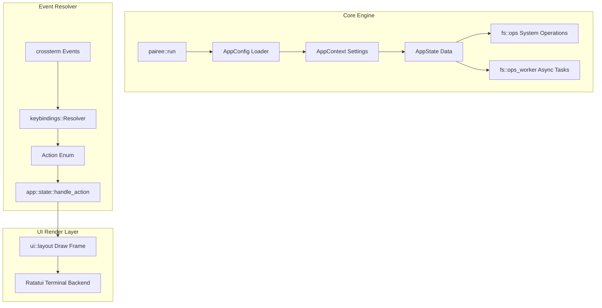
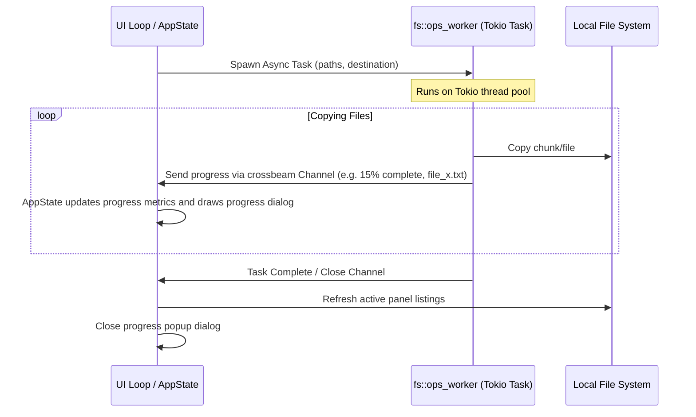

# Pairee Developer & Architecture Manual

This document details the software design, structure, runtime workflows, and code patterns utilized within the **Pairee** terminal file manager.

---

## 🏛️ 1. Core Architecture & Decoupled State

Pairee is built on the core principle of **separating core application logic from the presentation (UI) layer**. 



### 1.1 Decoupled Terminal State
The core business logic does not import `ratatui` or handle console outputs directly.
* All directory listings, glob filtering, active operations state, selected files lists, and background tasks channels are housed inside `AppState` (`src/app/state/mod.rs`) and `AppContext` (`src/app/context.rs`).
* This enables writing standard Rust unit tests for directory changes, sorting options, and path manipulations without mocking terminal devices.
* End-to-end smoke scenarios (`src/smoke_tests/`) use the test harness in `src/test_harness/` (test builds only): a `Harness` runs the real state over a temporary sandbox (both panels and every per-user directory, so the real configuration is never touched), sends key scripts such as `h.keys("@copy Enter")` through the event-loop dispatcher (`@action` replays the active keymap's chord), drains background jobs and paints frames on a `TestBackend` for screen assertions.

### 1.2 The Event Loop (`app::run`)
The main execution sequence:
1. `src/main.rs` is a thin `#[tokio::main]` wrapper; `pairee::run` (`src/run.rs`) builds `AppContext` and `AppState`.
2. `app::run()` starts terminal raw mode using `terminal::backend`.
3. An asynchronous loop listens for terminal resize and key inputs via `terminal::events`.
4. Resolved inputs mutate state parameters and trigger corresponding filesystem changes.
5. The TUI drawing layer paints when the dirty flag is set (DEC 2026 synchronized update; full-screen clear only on resize or screen-mode restore).

---

## ⌨️ 2. Keybinding Resolution Engine

Pairee supports custom presets (`norton`, `vim`, `modern`) without bloating UI components with key listener logic.

### 2.1 Event Flow
Keyboard event processing follows a strict unidirectional flow:
1. `crossterm::event::KeyEvent` is captured by the background event producer.
2. The key event is sent to the resolver: `keybindings::resolver::resolve(key, active_preset)`.
3. The resolver returns a logical `keybindings::actions::Action` variant.
4. The action is handled by the application state handler: `app::state::handle_action(action)`.

```rust
// Logical mapping example from keybindings/resolver.rs
pub fn resolve(key: KeyEvent, preset: &str) -> Option<Action> {
    match preset {
        "vim" => resolve_vim_preset(key),
        "norton" => resolve_norton_preset(key),
        _ => resolve_modern_preset(key),
    }
}
```

---

## 🔄 3. Asynchronous Operations & Worker Pattern

For long-running disk operations (Copy, Move, Wipe, Delete), blocking the main rendering loop causes the UI to freeze. Pairee solves this by delegating heavy disk tasks to a background thread pool managed by `tokio`.



### 3.1 Progress Channel Lifecycle
* **Task Spawning:** When `Action::Copy` is resolved, `fs::ops_worker::spawn_copy_task` is triggered.
* **Worker Execution:** A background thread handles file enumeration, path checks, read/write loops, and system calls.
* **Progress Reporting:** The worker sends `CopyProgress` updates via a channel sender. The structure reports:
  ```rust
  pub struct CopyProgress {
      pub current_file: String,
      pub files_copied: usize,
      pub total_files: usize,
      pub bytes_copied: u64,
      pub total_bytes: u64,
  }
  ```
* **UI Redraw:** On each tick, the main UI thread drains outstanding updates from the channel receiver into the state variables. If a background operation is active, `ui::popup::prompts::render_prompt_popup` displays a dynamic progress bar widget.

---

## 🌐 4. Centralized Localization & Translations

Translations are handled systematically to prevent code redundancy and hardcoded UI string issues.
* **English Strings:** All default English UI text labels are defined centrally in the embedded [en.toml](file:///d:/GitHub/NCRust/lang/en.toml) file, resolved via `get_default_english_translation(key)`.
* **External & Embedded Translations:** Non-English languages (like Spanish) are compiled directly into the binary ([es.toml](file:///d:/GitHub/NCRust/lang/es.toml)) for portability, and can be overridden dynamically by external TOML files in the `lang/` directory at startup.
* **Translation Helper:** Code files utilize `t("translation_key")` to resolve messages. If a localized file is missing, the engine falls back to default English definitions.

---

## 🖥️ 5. Standalone Terminal Launcher

To support launching Pairee as a desktop app without an open parent terminal session:
* On startup, `pairee::run` invokes `terminal::standalone::check_and_launch_standalone()`.
* **Windows Behavior:** The program detects if it was launched from explorer (no parent console attached). If so, it invokes a new shell wrapper (e.g., `cmd.exe` or `powershell.exe`) with the necessary window parameters, hosting the Pairee executable.
* **Linux/macOS Behavior:** Spins up a default system terminal emulator (e.g., `xterm`, `gnome-terminal`, `kitty`) to launch the application.

---

## 🎨 6. Theme Engine & Colors

* Themes are styled via individual TOML profile documents.
* Themes map logical UI elements (e.g. `panel_border`, `file_executable`, `menu_selected`) to terminal-friendly color palettes (e.g. `Color::Blue`, `Color::Rgb(r,g,b)`).
* `ui::theme_apply::parse_color` interprets the TOML strings, translating them into `ratatui::style::Color` rules applied directly during frame draws.
* **Syntax highlighting** (`src/syntax/`, no ratatui, only the `regex` crate): Pairee's own highlighter in the style of the micro editor. Each language is a TOML file in `syntax/` (embedded by `builtin.rs`; parsed by `definition.rs`) that lists how files are detected (names, a file name pattern, extensions, a first-line pattern) and rules (a pattern or whole words → a `SyntaxKind`: comment, string, keyword, constant, function, type, operator, tag) plus regions (start / end / skip patterns, with their own rules and nested regions). `grammar.rs` compiles a language once, on first use, flattening the regions into a vector; `highlight.rs` paints one line: the open region's end or the earliest sub-region start splits the line, each stretch takes the region's kind and then its rules in order (later rules paint over earlier ones), and the list of open regions is the state carried to the next line. A region's `end` may use the start's captures (`${1}`, `template.rs`: rendered escaped and compiled when the region opens, a small LRU per region), `after` is a pattern on the text before a start (regular expression literals vs division), and `include` highlights the inner text with another language: each open region records the language that declares it, its captured end and the language it embeds, so the line state nests grammars (at most 4 embedded levels) and the end of an embedding region closes it whatever the inner language left open; `host` makes a language's files start in another one (PHP in HTML). `painter.rs` holds the searches and the paint of one line. Work per line is bounded (first 4 KiB, a search budget; the `regex` crate matches in linear time). `registry.rs` puts the user's `<config>/syntax/*.toml` files before the built-ins (same name replaces), loaded at startup and reloaded when the folder changes (`app/syntax_reload.rs`, a folder monitor of `fs::watch`) or with `reload_syntax_definitions`; invalid files are reported, never fatal, and keep the language they defined before. The UI paints each kind with the theme's `[syntax]` colors (`ResolvedTheme::syntax`). `SyntaxCache` highlights only the requested lines, keeping line states every 64 lines (dropped from an edited line on) and restarting near the screen after a far jump. The editor re-detects the language after "save as" and the configuration dialog re-applies changed highlighting settings to open editors and viewers. The editor and the viewer paint lines through one layered painter (`ui::styled_line`: syntax, then search matches, then selection).

---

## 🔄 7. Auto-Update System

Pairee features a non-blocking, smart software update mechanism designed to query, download, verify, and apply releases across multiple distribution methods and host platforms.

### 7.1 Module Architecture (`src/update/`)
The module is decomposed into focused subcomponents:
* **Installation Method Detector (`detect.rs`):** Determines the method used to install Pairee (e.g., native Linux package managers, Windows installers, manual zip, or manual tarball extract) out of 13 supported profiles.
* **GitHub Release Checker (`checker.rs`):** Queries the GitHub Releases API asynchronously, matching version tags against the current build using semantic versioning (`semver`). A local file-based cache (`update_cache.json`) expires after 1 hour to prevent hitting API rate limits.
* **Streaming Downloader (`downloader.rs`):** Performs segment-by-segment streaming downloads of release assets with live progress report callbacks. It secures the download by computing the SHA-256 hash of the received file and comparing it against the remote release's `.sha256` sidecar asset.
* **Installer Execution Engine (`installer.rs`):** Applies the downloaded update. It performs an atomic binary swap for manual Linux installs, executes Windows Inno Setup packages silently, or creates a self-cleaning helper batch script to replace manual Windows ZIP binaries. For package-manager-tracked environments, it renders copy-to-clipboard terminal update commands.

### 7.2 Event Flow & Background Tasks
1. **Startup Check:** If `auto_update_check` is enabled, a Tokio background worker is spawned at boot to query release APIs.
2. **Visual Notification:** When a new version is detected, a yellow `▲ UPDATE` indicator badge is drawn at the top-right header of the application frame.
3. **Interactive Menu/Popup:** Selecting the update indicator or choosing "Check for updates" in the Options menu opens a dedicated Ratatui popup. It presents the release notes (changelog), version differences, and three choices: "Install Now", "Ignore Version" (updates settings to skip this version tag), or "Close".
4. **Live Progress:** Choosing install starts a background download task. The popup displays a live progress gauge showing byte transfer rates. Once completed, it prompts the user to restart the application.

---

## 🗄️ 8. Panel Sources (VFS port)

Panels never special-case where their entries come from. `fs::vfs::Vfs` is the port (Ports & Adapters): `list`, `stat`, `open_read`, `write_file`, `mkdir`, `remove_*`, `rename`, plus provided operations built on them (`remove_all`, `walk`, `mkdir_all`, `read_prefix`, `open_store` for the viewer, `read_panel` for listings, `du_list` for folder sizes) and `Capabilities` flags (write, mkdir, remove, rename, attributes, local tools). `attributes` / `set_attributes` back the Attributes dialog (SFTP: `stat` / `setstat`).

| Adapter | Where | Capabilities |
| :--- | :--- | :--- |
| `LocalVfs` | `fs/vfs/local.rs` | everything; listings keep the elevated retry, folder sizes keep hard-link identities, the viewer pages files from disk |
| `SharedSshClient` | `fs/ssh/vfs.rs` | everything but local tools (one SFTP call per lock) |
| `FtpVfs`, `WebDavVfs`, `S3Vfs` | `fs/remote/` | everything but local tools and attributes |
| `ArchiveVfs` | `fs/archive/vfs.rs` | read-only for tar (plain, gzip, bzip2, xz) and 7z; zip adds write, mkdir and remove (rewrite to a temp file, atomic rename) |

**Remote connections.** Panels, transfers (`TransferJob::remote`, `RemoteEndpoints`, `backend::remote`), the journal and auto-refresh hold a remote place as an `fs::remote::RemoteConn`: the adapter (`Arc<dyn Vfs>`) plus a `RemoteInfo` (kind, host, port, user; never a secret), whatever the protocol, so copies and moves run between any pair of local and remote endpoints and a move within one connection is a rename. Saved connections are `config::settings::Connection` (`[[connections]]`; older `[[ssh_presets]]` load as SFTP); `fs::remote::open` connects one (SFTP through the SSH client, the others through the URL factory `fs::remote::connect`). Their secrets live in the keyring (`config::credentials`: `connection:<name>` entries plus an index; a read error marks the connection `secret_unread` so a save never deletes the entry). The connection manager dialog (`ConnectionPromptState`) creates, edits, deletes and connects them through the `remote_connect` job slot.

**Credential requests.** A background job that needs a secret (an SFTP, FTP, WebDAV or S3 login; an encrypted SSH key, also in Git fetch / pull / push) asks through `credential_prompt`: an `Asker` sends the request over a channel and blocks the job's thread until the answer; the UI side (`app::credential_requests`) shows each one as a `CredentialPrompt` pushed over the open dialogs and sends back the typed secret, or `None` on Esc or when the prompt disappeared. Connections get the asker of the state that started them; Git uses the process-wide one `run` installs. Requests from the answering thread are refused instead of deadlocking.

One-off changes of a non-local source run in the background through `AppState::start_vfs_task`, which returns a follow-up command for the UI thread. F4 on an SFTP or zip entry uses it: `app::editor::remote` downloads the file into a private temp folder, the editor keeps a `RemoteOrigin` (source, path, size and time) and saving uploads the copy after comparing the original with that stamp.

`PanelState::source` (`PanelSource`: `Local`, `Remote`, `Archive`) plus `current_path` is the panel location. Archive paths are `archive.ext/inner/path`, so `..`, history and the title work unchanged; `PanelSource::locate` switches the source when a refresh enters or leaves an archive file. Listing, folder sizes, the disk usage view, multi-rename (and its undo), compare/synchronize, the viewer and Quick View all go through the port, and `app::actions::fs_ops::capability` refuses actions a source cannot run with one message.

An archive stored in an archive is browsed read-only: `PanelSource::locate` asks `ArchiveVfs::nested_at` for the archive entry on the way to the path, and the nested `ArchiveVfs` reads its data through `archive::nested::ArchiveData`, which extracts the entry to a temp file on first use (in the listing job) with a 512 MiB cap and keeps the parent archive for leaving it. Transfer plans refuse paths below such an entry.

Archive formats are a second Strategy (`fs::archive::format::ArchiveReader`, one reader per format) shared by extraction, listing and browsing. The Transfer Engine picks `backend::archive_vfs` when a job's source or destination lies inside an archive: copies out use the safe extractor (`ExtractGuard`), copies into a zip and deletions inside it rewrite the archive. Existing destinations go through `transfer::conflict_resolver::ConflictResolver`, the same resolver the local worker uses, which reads the destination through its `Vfs`. Every adapter runs the same contract suite (`fs/vfs/contract.rs`, one generic check per capability instantiated per adapter with `vfs_contract!`).

---

## 🗂️ 9. Folder Tabs

`PanelPair` holds one `PanelTabs` per side (`app/state/tabs/`): an ordered `Vec<Tab>` plus the active index. A `Tab` owns a whole `PanelState` (path and `PanelSource`, listing, cursor, selection, view, sort, filters, folder sizes and their `JobSlot`s), an optional user title and an optional `TabLock`. `PanelPair::side()` / `AppState::get_active_panel()` return the active tab's panel, so code that works on "the panel" did not change.

* **Routing:** every tab has a `TabId`, unique for the run and stable across moves. Background jobs live in the tab's own `JobSlot`s (generation-tagged), `poll_panel_listings` drains every tab of both sides, and jobs started outside the panel (remote connect) carry the `TabId` and are dropped when the tab was closed. A listing therefore always lands in the tab that asked for it, shown or not.
* **Commands:** `app/state/tab_ops.rs` (duplicate, close, activate, cycle, move, lock, rename) and `app/actions/tabs.rs` (keymap actions). Switching tabs rereads the newly shown tab. A locked tab is enforced in `refresh_tab`: when its path left the lock, it returns to the locked folder and the new location opens in a tab next to it.
* **Rendering:** `ui/tab_bar.rs` lays out the titles (widest shrink first, then a window around the active tab) and records the painted cells in `AppState::tab_bar` for mouse clicks (`app/app/tab_mouse.rs`).
* **Persistence:** `Tab::spec()` / `Tab::from_spec()` convert to `TabSpec`, a plain serde struct (path, source kind, view, sort, filter, title, locked, cursor entry, saved connection name) with no UI or runtime types.
* **Session:** `app/session/` owns the startup and exit lifecycle. `start()` applies the "Save setup" defaults, then `config::session::SessionFile` (`session.toml`, read and written through `config::toml_store` like bookmarks and history) and finally the command-line folders (`launch_args.rs`) on the shown tabs. Restored remote tabs carry a `PendingRemote` and connect from their saved connection the first time they are shown (`session/remote.rs`, through the same `remote_connect` slot as the connection dialog). `persist_on_exit()` writes setup, history and session and returns the folder for `--cwd-file` / `--print-cwd`.

---

## 👁️ 10. Panel Auto-Refresh

`fs::watch` monitors folders; `app::auto_refresh` decides which ones and applies the changes.

* **Observer:** a `DirMonitor` runs on its own thread per monitored folder and reports `DirChange { dir, entries }` to a `ChangeSink` (a channel plus `app::jobs::wake_event_loop`, the same `Notify` that finished jobs use). Dropping the monitor stops it.
* **Strategy:** `ChangeStrategy` has two implementations: `WatchStrategy` (`notify`, `RecursiveMode::NonRecursive`, access events ignored, lost events turned into a whole-folder change) and `PollStrategy` (compares `DirSignature`, the folder's modification time plus entry count, every `auto_refresh_poll_secs`). `strategy_chain` picks `[Watch, Poll]`, or `[Poll]` for those `needs_polling` flags (UNC/mapped network drives and `\\wsl$` on Windows; NFS/SMB, 9p, drvfs and FUSE mounts from `/proc/mounts` on Linux). The chain runs on the monitor thread, so slow network checks never block the UI, and a watch that cannot be armed falls back to polling.
* **Coalescing:** `Coalescer` (pure, the caller passes the clock) merges changes per folder and releases one when the folder has been quiet for 250 ms, or 2 s after the first change of a burst that never goes quiet.
* **Application:** every event-loop pass `AppState::poll_auto_refresh` syncs the monitors with the folders of the active tab of each side (archive tabs and folders above `disable_panel_update_object_count` are skipped; SFTP tabs only with `auto_refresh_ssh`, through `DirMonitor::start_polling`, which runs `PollStrategy` over the tab's `Vfs` on the SFTP interval). Monitors, changes and the `Coalescer` are keyed by `WatchOrigin` (local disk or SFTP connection id) plus folder, so equal paths on two filesystems never mix, so monitors re-arm when a tab changes folder, switches or closes. A due change rereads every local tab on that folder with `refresh_tab_quietly` (the normal listing path, which also recomputes Git status; `quiet_listing` hides "Loading…"), invalidates the changed folders' sizes (`DirSizes::invalidate`, measured again) and is deferred when the tab is still loading, so a long copy does not restart listings.

## 🖱️ 11. Mouse

* **Capture:** `terminal::mouse` decides whether the terminal reports the mouse (`EnvProbe`: TTY, `TERM`, Windows console, `PAIREE_MOUSE`, `--no-mouse`) and owns the process-wide capture flag. The event loop applies `settings.mouse` (`auto`/`on`/`off`) and `toggle_mouse_capture` on every pass; `terminal::suspend` releases capture (with raw mode and the alternate screen) while a child process owns the terminal.
* **Hit map:** every frame records what it paints where (`ui::hit`): widgets call `hit::register(area, HitTarget)` while drawing, through a thread-local buffer that `draw_ui` collects into `AppState::hits`, so renderers need no extra parameter. Painting order is stacking order; `begin_layer(Popup)` marks the dialogs. Scrollbars, tabs, panel rows, menus, F-keys and dialog controls all live there.
* **Router:** `app::mouse::handle` looks the pointer up in the last frame and acts: drags it started (row tagging, panel split, dialog move/resize, file drag) keep the pointer until release, then scrollbars, then presses (`ClickCounter` derives double clicks). Dialogs are modal: a press outside closes transient ones (`Dialog::closes_on_outside_click`) as `Esc` would. Wherever a key does the same, the router dispatches that key's `Action`.
* **Dialogs through their keys:** a dialog control records the keys that reach and use it from the current focus (`PopupKeys`, `PopupRow { steps, focus }`, `PopupField`); `kit::mouse::FormFocus` derives them from a `FormLayout`. The router presses them through the dialog's own key handler, stopping if the dialog changes, so no dialog has mouse-specific state.
* **Placement:** `ui::placement` applies the open dialog's offset and extra size inside the centering helpers, so every centered dialog moves without code of its own; `app::mouse::dialog_drag` keeps it per dialog (stack depth + kind) and resumes from what the last frame could honour.
* **Drag and drop:** `app::mouse::file_drag` turns a press on a row into a drag, `drop_target` resolves the folder (or the command line) under the pointer and `fs_ops::transfer::start` runs the F5/F6 path with explicit SSH endpoints; `ui::drag_label` draws the pointer label.
* **Tests:** `test_harness` has `click`, `double_click`, `right_click`, `middle_click`, `wheel`, `drag`, `hover`, `hit_cell` and `locate`; `smoke_tests::mouse` covers the behaviour, including a dialog coverage test.

---

## 🪟 12. Dialogs

Every overlay dialog is a type of its own, listed once in `dialog_list!` (`app/state/popup/mod.rs`) as `Variant(Type)`. Everything else is generated from that list or answered by the type:

* **State and input (`app`, no ratatui):** the type implements `app::state::popup::Dialog`: `key_handler` (the function that gets the keys while it is on top, with the whole `AppState`), `closes_on_outside_click`, `resizable`, `focused_field_mut` (pastes, and no `[list]` key translation while typing), `scroll_mut` (what a scrollbar moves: `DialogScroll::Offset`, `Cursor` or `OffsetAndCursor`) and `reads_raw_keys`. State types live in `app/state/popup/` by family (`messages`, `confirm`, `prompts`, `filters`, `editor_viewer`, `menus`, `tools`, `settings`, `git_prompts`, ...); their `impl Dialog` sits next to the key handler in `app/input_popup/`. Families share one handler where the keys are the same (e.g. `confirm_dialogs::handle::<T>` over the `Confirmation` trait for every Yes/No question).
* **Painting (`ui`):** the type implements `ui::popup::view::DialogView` (`render(&self, frame, &ViewCtx)`, where `ViewCtx` carries state, context, theme, screen and panel areas). `ui::popup::view::render_dialog` is generated from the same list, so a dialog without a view does not compile.
* **One dispatch point:** `define_popup_type!` turns the list into `PopupType` (pattern matching, `Clone` and `Debug` keep working), `PopupType::dialog()` / `dialog_mut()` (the only match over all dialogs), `From<Type> for PopupType` and `DialogKind` (typed access: `DialogStack::top_as::<T>()`, `top_mut_as`, `pop_as`). This is an enum dispatch rather than `Box<dyn Dialog>`: the set is closed and known at compile time, painting stays in the UI layer without a runtime registry, and the dialog state keeps deriving `Clone`.
* **Adding a dialog:** its type, `impl Dialog`, `impl DialogView` and one line in `dialog_list!`. No central match changes.
* **Stack:** `DialogStack` holds the open dialogs; the top one gets the keys and the mouse, all are painted bottom to top (those underneath without hit targets, `hit::muted`, and at their own position, `placement::unplaced`). `replace` opens a dialog alone; `push` / `pop` nest one where the dialog underneath stays valid: the Copy / Move file mask and folder tree, every Git prompt over the Git panel, the screens list (F12) over the current screen's dialogs, the development plugin picker over the Plugin Manager, the color dialogs over the configuration dialog (saving them also updates its draft, so OK does not undo them) and messages over any dialog.

---

## 🔭 13. Views over the files

Four features read the panels' files; their core lives outside `ui` and the screens only paint it.

* **Branch view** (`branch_view`): `PanelState::branch_view` makes the listing job call `fs::list::branch::read_branch`, which walks the folder with the shared `Walker` (any `Vfs`, links kept but not entered, hidden folders pruned unless shown, cancellable) and names each file by its relative path. The job reports the files found (`JobSlot<PanelListing, ListingProgress>`) for the panel title. `start_refresh` turns it off when the panel leaves the folder; Git statuses are keyed by the whole relative path; rename works in the file's own folder.
* **Folder frecency** (`config::frecency`): `FrecencyStore` ranks folders as zoxide does (rank +1 per visit, weighted ×4 / ×2 / ×½ / ×¼ by the age of the last visit, all ranks scaled down past a total of 10 000, at most 500 folders) and matches queries with `nucleo-matcher` (every word must match; folders whose name matches the last word first). `start_refresh` records each local folder a panel enters. It is loaded and written (atomically, `toml_store`) only while `save_folders_history` is on. The folder jump list (`app::folder_jump`) and `z <words>` on the command line (`app::input::cli_cd`) read it.
* **Diffs** (`crate::diff`): one model, `DiffDocument` (lines with kind and line numbers), built from a unified patch (Git) or from two texts with `similar` (`diff::text`), plus a side-by-side layout. `diff::files::compare_files` reads two files through their `Vfs`, decodes them as the viewer does and diffs them, or compares sizes and BLAKE3 hashes for binary or files over 8 MiB. `DiffViewer` (state) and `ui::popup::diff_view::DiffBox` (painting) serve both the Git diff and Compare files.
* **Duplicate finder** (`app::dupes`): runs `fs::dupes::find_duplicates` in a `JobSlot` with progress, reads the modification times of the duplicates, and keeps the marks; `fs::dupes::keep` chooses the copy to keep (first, newest, oldest) and drops deleted files from the report. Deleting goes through the regular delete flow; `TransferJob::ran_on` tells whether a finished delete job concerns the searched source (shared with the disk usage view).
